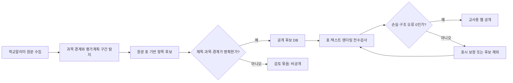

# 타 교과 평가계획 검증 인수인계

작성일: 2026-08-15  
기준: 2026 수학 수행평가 아이디어 아카이브의 교사 제보·전수검사 보정 과정  
목적: 다른 교과의 학교알리미 교수학습·평가계획을 **원문을 바꾸지 않고**, 수행평가 단위로 안전하게 탐색·표시·검수하기 위한 재사용 묶음

## 먼저 지켜야 할 원칙

1. 원문에 없는 수행평가명을 생성하지 않는다. 제목은 `평가명`, `평가 영역명`, `수행평가명`처럼 원문 표가 명시한 셀이나 명확한 항목 머리글에서만 확정한다.
2. 제목·과목·경계가 애매하면 공개 후보에서 제외하고 검토 묶음으로 남긴다. 자동 추정으로 빈칸을 채우지 않는다.
3. PDF/HWP/HWPX 변환 결과는 원문이 아니라 **안전 변환 재현본**이다. 표·지면 배치·병합은 달라질 수 있으므로 원문 링크와 대조 안내를 남긴다.
4. 표의 보기는 고쳐도 텍스트 셀·배점·루브릭·성취기준의 의미를 고치지 않는다. 셀 삭제는 모든 행에서 빈 열임을 증명할 때만 허용한다.
5. 공개 전에는 제목, 과목 정합성, 원문 경계, 개인정보 패턴, 렌더링 손실을 각각 독립적으로 검사한다.

## A. 교사 캡처로 발견되어 고친 문제

아래는 실제 화면 제보를 유형화한 것이다. 교과가 달라도 동일한 확인 질문과 금지 규칙을 적용한다.

| 제보 증상 | 실제 위험 | 적용한 보정·판정 | 타 교과 적용 기준 |
| --- | --- | --- | --- |
| 평가명이 `교과협의회에서 협의…`, `AI 활용 가능` 같은 운영 문장으로 표시됨 | 평가계획 일반 안내문을 수행평가명으로 오인 | 구조적 제목·운영 문장·성취수준 문장 패턴을 제목 후보에서 제외. 원문 표의 명시 셀이 없으면 비공개 검토 묶음 유지 | ‘평가 계획’, ‘유의 사항’, ‘평가 결과 활용’, ‘성취수준 설정’, ‘운영 지침’ 등 교과 공통 구조어는 제목으로 금지 |
| 한 학교의 수행평가 2~3개가 대표 제목 하나로만 보임 | 서로 다른 과제·배점·루브릭이 한 항목에 섞임 | `평가 영역명`과 수행 구조·해당 과목 성취기준이 함께 있는 원문 조각만 개별 항목으로 분리 | 단일 제목 + 단일 수행 구조 + 단일 과목 근거 + 중복 없음이 모두 성립할 때만 분리 |
| `영역별`, `학기 단위 성취수준 설정`, `성취기준` 등이 평가명으로 보임 | 표의 열 이름·단원명·성취수준 표제를 과제명으로 오인 | 구조 제목 차단과 제목 근거(`table`, `heading`)를 분리. 엄격 제목 감사에서 걸리면 공개 제외 | 제목만 보고 판단하지 말고, 인접 표에 평가방법·시기·배점·루브릭 중 2개 이상의 수행 표지가 있는지 확인 |
| 다른 과목 내용 또는 공통 안내 표가 해당 과목 사례에 포함됨 | 과목별 라이브러리가 오염되고 교사가 잘못 재사용 | 과목 머리글·압축파일 문서 경계·성취기준 코드·과목명 근거를 별도 감사. 불일치 항목은 공개 제외 | 과목명 언급 1회만으로 통과시키지 말고, 과목 경계와 해당 교과 성취기준/평가 표지가 함께 있어야 함 |
| 원문 표가 한 표로 붙거나 잘려서 읽기 어려움 | A~E 성취수준·루브릭 문장이 서로 다른 표로 분리되고 가독성 저하 | 인접한 동일 머리글 표만 병합, A–C/D–E 연속 표만 조건부 결합, 빈 꼬리 열만 제거, 넓은 표는 내부 가로 스크롤 | ‘텍스트를 새로 조합하는 보정’은 금지. 병합의 양쪽에 같은 표제·연속 등급·이어지는 셀이 모두 있어야 함 |
| 원문 상세에서 왼쪽·오른쪽이 밀리거나 모바일에서 표가 잘림 | 화면 전체 가로 넘침, 교사가 표를 읽을 수 없음 | 표 컨테이너에만 가로 스크롤을 적용하고, 페이지 자체에는 가로 넘침이 없도록 점검 | 390px 안팎 화면에서 `문서 전체 overflow = false`, 주요 조작 대상 최소 44px 확인 |
| 카드의 평가방법·배점에 체크박스, 번호, 표 머리글이 섞임 | 카드 정보가 원문 의미를 왜곡 | 요약 필드는 보수적 전용 추출기로 다시 계산. 확정 불가면 빈값으로 두고 원문 표만 제공 | 요약은 편의 정보이며, 불확실한 값은 표시하지 않는 편이 정확함 |

### 제보 사례를 받을 때의 최소 기록 양식

다른 과목 담당자에게는 캡처만 받지 말고 다음을 함께 받는다.

```text
1) 화면 URL 또는 case_id / item_id
2) 화면에 표시된 잘못된 값
3) 원문에서 보여야 하는 값 또는 ‘원문에도 경계가 불확실함’ 여부
4) 문제 유형: 제목 / 과목 / 다중 항목 / 표 병합 / 잘림 / 요약 필드 / 기타
5) 모바일에서도 같은지
```

## B. 전수검사에서 스스로 찾아 고친 문제

| 검사 축 | 자동 탐지 내용 | 공개 처리 원칙 | 수학에서 사용한 구현·근거 |
| --- | --- | --- | --- |
| 제목 정확성 | 일반 지침, 열 이름, 성취수준 문장, 숫자·배점만 있는 제목, 합성 묶음 제목 | 명시 근거 없는 제목은 검토 묶음. 엄격 제목 감사 통과 항목만 공개 | `scripts/math_assessment_detail_parser.py`, `scripts/audit_math_assessment_titles_full.py`, `data/derived/math_assessment_multitask_title_audit_v8.json` |
| 다중 수행평가 경계 | 한 사례에서 여러 `평가 영역명`·수행 구조가 섞인 원문 묶음 | 원문 표 제목·과목 근거·수행 구조·중복 방지·표 구조 조건을 모두 통과한 조각만 분리 | `scripts/propose_math_assessment_unbounded_bundle_splits.py`, `data/derived/math_assessment_multitask_bundle_v2_proposals.jsonl` |
| 과목 정합성 | 이전/다음 과목, 공통 계획, 성취기준 표가 섞인 경우 | 직접 과목 근거가 없는 조각은 공개 제외 | `scripts/audit_math_assessment_subject_alignment.py`, `data/derived/math_assessment_multitask_subject_audit_v8.json` |
| 제목 외 요약 필드 | 평가방법, 시기, 배점, 반영비율, 개요, 성취기준의 표 셀 오인 | 원문 추적 가능하고 형식이 맞는 값만 카드에 노출 | `scripts/repair_math_assessment_item_fields.py`, `scripts/apply_math_assessment_table_boundary_repairs.py` |
| 표 구조 | rowspan/colspan 이상, 빈 열, 분리된 연속 표, 과도하게 넓은 표 | 보이는 구조만 최소 보정하고, 구조 경계가 불확실하면 원문 묶음으로 유지 | `scripts/audit_math_assessment_table_structure.py`, `apps/math-assessment-web/app/lib/source-table-segmentation.ts` |
| 원문 손실 | HTML 변환·표 보정 뒤 원문 텍스트 조각이 사라지는지 | 한 조각이라도 손실되면 실패 | `apps/math-assessment-web/scripts/audit-source-table-renderer.mjs` |
| 개인정보·공개 범위 | 이메일·전화번호·주민번호 패턴, 비경계 원문, 전체 문서 | 고위험 패턴은 배포 중단, 경계 불명 원문은 공개하지 않음 | `scripts/package_math_assessment_vercel_data.py`, `docs/SOURCE_POLICY.md` |

## C. 수학에서 실제로 확정한 변경 범위

- 비공개 다중 수행평가 묶음 6,784개를 재검토했다.
- 표 경계 후보 102개 중 원문 근거가 명확한 20개만 개별 수행평가로 확정했다.
- 11개 학교·과목 사례에 영향을 주었고, 나머지는 검토 묶음으로 유지했다.
- 확정 후보의 원문·루브릭 38개와 공개 전체 원문·루브릭 19,703개를 렌더링했다.
- 전체 렌더링 결과: 복호화 실패 0, 렌더링 실패 0, 텍스트 손실 0, 성취수준 분리 오류 0, 표 구조 오류 0.

이 수치는 **수학 데이터의 결과**다. 다른 교과에 복사하면 해당 교과의 산출물로 다시 계산해야 하며, 수치를 재사용하면 안 된다.

## D. 타 교과용 권장 파이프라인



### 필수 게이트

1. **원문·과목 게이트**: 과목의 시작과 끝, 평가계획 앵커, 성취기준 코드/과목 표지가 모순되지 않는다.
2. **제목 게이트**: 제목이 원문 표·명시 머리글에서 직접 확인되고 구조어·운영문·성취수준 문장이 아니다.
3. **항목 경계 게이트**: 한 항목 안의 평가방법·배점·루브릭·성취기준이 같은 수행평가를 가리킨다.
4. **요약 필드 게이트**: 카드에 보이는 각 값이 원문에서 다시 찾을 수 있다. 불확실하면 빈값이다.
5. **표 게이트**: 텍스트 손실 0, 불가능한 rowspan/colspan 0, 화면 전체 가로 넘침 0.
6. **공개 게이트**: 개인정보 패턴 0, 원문 범위 제한, 출처 링크·정정 요청 경로 제공.

## E. 재사용 가능한 산출물

| 목적 | 수학의 파일 | 타 교과에서 바꿀 부분 |
| --- | --- | --- |
| 손실 최소화 상세 파싱 | `scripts/math_assessment_detail_parser.py` | 과목명·성취기준 코드·평가 앵커 사전 |
| 제목 전수 감사 | `scripts/audit_math_assessment_titles_full.py` | 구조 제목·교과별 금지 제목 패턴 |
| 과목 오염 감사 | `scripts/audit_math_assessment_subject_alignment.py` | 과목별 코드·동의어·공통 과목 규칙 |
| 표 구조 감사 | `scripts/audit_math_assessment_table_structure.py` | 원문 변환기별 표 경고 기준 |
| 원문 표 표시 보정 | `apps/math-assessment-web/app/lib/source-table-segmentation.ts` | 그대로 재사용 가능. 교과 내용에는 의존하지 않음 |
| 브라우저 렌더링 감사 | `apps/math-assessment-web/scripts/audit-source-table-renderer.mjs` | 대상 DB와 공개 상태 필터 |
| 공개 정밀 게이트 | `scripts/audit_math_assessment_release_precision.py` | 교과별 제목·과목 사전 |
| 공개 패키징·개인정보 스캔 | `scripts/package_math_assessment_vercel_data.py` | 서비스명·공개 정책·추가 민감정보 패턴 |

## F. 인수인계에 함께 줄 원본 증빙

다음 파일은 ‘수학에서 무엇을 통과시켰는지’를 재현하는 증빙이다. 원문 자체나 학교별 전체 문서는 다른 교과 팀에 전달하지 않는다.

- [다중 항목 분리 원칙과 결과](MULTITASK_BOUNDARY_RECOVERY_V2_2026-08-15.md)
- `data/derived/math_assessment_multitask_bundle_v2_proposals.jsonl`: 후보별 원문 해시·판정 신호·거절 사유
- `data/derived/math_assessment_multitask_bundle_v2_apply_v8_report.json`: 후보 DB 적용 기록
- `data/derived/math_assessment_multitask_precision_audit_v8.json`: 제목·필드·중복·공개 정밀 게이트
- `data/derived/math_assessment_multitask_subject_audit_v8.json`: 과목 정합성 감사
- `data/derived/math_assessment_multitask_title_audit_v8.json`: 엄격 제목 감사
- `data/derived/math_assessment_multitask_detail_audit_v8.json`: 상세 DB 무결성·표시값 추적성
- `data/derived/math_assessment_multitask_publication_gate_v8.json`: 공개/검토 제외 집계
- `data/derived/math_assessment_renderer_full_v8_shard-0.json` ~ `shard-3.json`: 공개 전체 원문 렌더링 결과

## G. 다른 교과 담당자에게 전달할 요청문

```text
학교알리미 평가계획 원문을 근거로 [교과명] 수행평가 탐색기를 만들고 싶습니다.

원칙은 다음과 같습니다.
- 수행평가명은 원문 표나 명확한 항목 머리글에서 직접 확인될 때만 확정합니다.
- 일반 운영 문장, 성취수준 표제, 단원명, 평가요소는 수행평가명으로 만들지 않습니다.
- 여러 수행평가가 한 원문 묶음에 있으면, 원문 표의 평가영역명·수행 구조·해당 교과 성취기준 근거가 모두 맞는 조각만 분리합니다.
- 과목 경계가 불확실하거나 원문에서 이름을 확정할 수 없으면 공개하지 않고 검토 묶음으로 남깁니다.
- PDF/HWP/HWPX 표는 원문 텍스트 손실·rowspan/colspan 이상·모바일 가로 넘침을 전수 검사합니다.
- 카드 요약의 평가방법·시기·배점·반영비율은 원문에서 추적 가능한 값만 노출합니다.
- 원문 상세는 안전 변환 재현본임을 고지하고, 학교알리미 원문 링크·정정 요청 경로를 제공합니다.

검증 산출물은 제목 감사, 과목 정합성 감사, 표 구조 감사, 렌더링 감사, 공개 게이트로 분리해 남겨 주세요.
```

## H. 완료 판정

다음 중 하나라도 ‘아니오’면 완료라고 부르지 않는다.

- 공개 수행평가명마다 원문 근거 위치 또는 원문 조각 해시가 있는가?
- 다른 과목의 성취기준·운영표·수행평가가 섞이지 않았는가?
- 여러 수행평가가 하나의 카드로 남아 있지 않은가? (확정 근거가 없으면 비공개 검토 묶음으로 남겼는가?)
- 원문 표 렌더링 후 텍스트 손실과 구조 오류가 0인가?
- 데스크톱·390px 내외 모바일에서 페이지 전체 가로 넘침이 없는가?
- 공개 원문은 범위가 제한되고, 개인정보 패턴·정정 요청·원문 대조 안내가 있는가?

이 문서는 ‘모든 자동 추출을 무조건 공개하는 방법’이 아니라, 교사가 근거를 확인할 수 있도록 **확정 가능한 것만 공개하는 방법**을 정리한 것이다.
